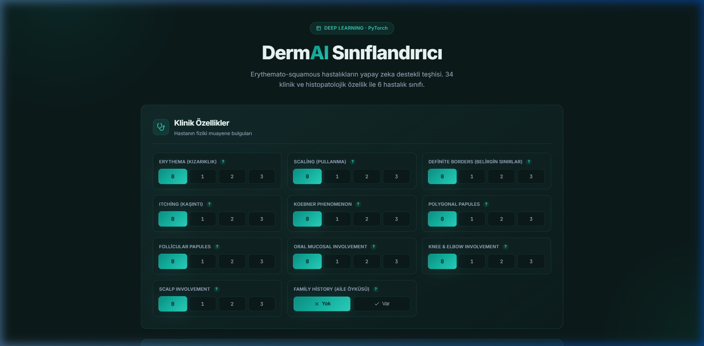

# DermAI — Erythemato-Squamous Hastalıklar Sınıflandırıcı

Dermatolojide birbirine klinik ve histopatolojik olarak çok benzeyen **6 farklı erythemato-squamous hastalığın** derin öğrenme ile otomatik teşhisini sağlayan uçtan uca bir projedir. Model, PyTorch ile geliştirilmiş olup FastAPI tabanlı bir web arayüzü üzerinden kullanılabilir hale getirilmiştir.

<p align="center">
  
</p>

---

## 📌 Proje Motivasyonu

Erythemato-squamous hastalıklar (sedef, seboreik dermatit, liken planus vb.) birbirine klinik olarak çok benzer ve ayırıcı tanı koymak deneyimli dermatologlar için bile zor olabilir. Bu projede:

- **UCI Dermatology** veri seti üzerinde kapsamlı veri analizi yapılmış,
- 34 klinik + histopatolojik özellik kullanılarak hastalık sınıflandırması modellenmiş,
- Model, gerçek zamanlı tahmin yapabilen bir web uygulamasına dönüştürülmüştür.

> **Not:** Bu proje eğitim ve araştırma amaçlıdır, tıbbi teşhis yerine geçmez.

---

## 🧠 Model Mimarisi

Tam bağlantılı (fully connected) bir sinir ağı kullanılmıştır:

```
Input (34 özellik)
    │
    ├── Linear(34, 64) → ReLU → Dropout(0.1)
    ├── Linear(64, 64) → ReLU → Dropout(0.1)
    └── Linear(64, 6)  → Softmax → Sınıf Tahmini
```

| Parametre | Değer |
|-----------|-------|
| Optimizer | Adam |
| Learning Rate | 0.01 |
| Loss Function | CrossEntropyLoss |
| Epochs | 120 |
| Test Split | %30 |
| **Test Accuracy** | **%99.07** |

### Eğitim Süreci

```
Epoch:   0 | Loss: 1.90371 | Acc: 18.40% | Test Acc: 28.70%
Epoch:  30 | Loss: 0.07082 | Acc: 98.40% | Test Acc: 98.15%
Epoch:  60 | Loss: 0.02262 | Acc: 99.60% | Test Acc: 99.07%
Epoch: 120 | Final Test Accuracy: 99.07%
```

---

## 📊 Veri Seti

**Kaynak:** [UCI Machine Learning Repository — Dermatology Dataset](https://archive.ics.uci.edu/ml/datasets/dermatology)

- **366 hasta** kaydı
- **34 özellik** (12 klinik + 22 histopatolojik)
- **6 hastalık sınıfı**

### Özellik Grupları

<details>
<summary><strong>Klinik Özellikler (12)</strong> — Fiziki muayene bulguları</summary>

| Özellik | Açıklama | Ölçek |
|---------|----------|-------|
| `erythema` | Ciltteki kızarıklık derecesi | 0–3 |
| `scaling` | Pullanma / kepeklenme | 0–3 |
| `definite_borders` | Döküntü kenarlarının belirginliği | 0–3 |
| `itching` | Kaşıntı şiddeti | 0–3 |
| `koebner_phenomenon` | Travma sonrası lezyon oluşumu | 0–3 |
| `polygonal_papules` | Çokgen şekilli kabartılar | 0–3 |
| `follicular_papules` | Kıl kökü etrafında kabartılar | 0–3 |
| `oral_mucosal_involvement` | Ağız içi mukoza tutulumu | 0–3 |
| `knee_and_elbow_involvement` | Diz ve dirsek tutulumu | 0–3 |
| `scalp_involvement` | Saçlı deri tutulumu | 0–3 |
| `family_history` | Ailede hastalık öyküsü | 0/1 |
| `age` | Hastanın yaşı | Sayısal |

</details>

<details>
<summary><strong>Histopatolojik Özellikler (22)</strong> — Biyopsi bulguları</summary>

| Özellik | Açıklama |
|---------|----------|
| `melanin_incontinence` | Melanin pigmentinin dermise sızması |
| `eosinophils_infiltrate` | İnfiltratta eozinofil hücre varlığı |
| `PNL_infiltrate` | Nötrofil iltihap hücresi yoğunluğu |
| `fibrosis_papillary_dermis` | Papiller dermiste bağ dokusu artışı |
| `exocytosis` | İltihap hücrelerinin epidermise göçü |
| `acanthosis` | Epidermis katmanının kalınlaşması |
| `hyperkeratosis` | Dış tabakanın kalınlaşması |
| `parakeratosis` | Tam olgunlaşmamış keratinleşme |
| `clubbing_rete_ridges` | Epidermis uzantılarında çomaklaşma |
| `elongation_rete_ridges` | Uzantılarda derinlemesine uzama |
| `thinning_suprapapillary_epidermis` | Papilla üstü epidermiste incelme |
| `spongiform_pustule` | Süngerimsi irinli boşluklar |
| `munro_microabcess` | Cilt altı mikro apse birikimi |
| `focal_hypergranulosis` | Granüler tabaka kalınlaşması |
| `disappearance_granular_layer` | Granüler tabakanın kaybolması |
| `vacuolisation_damage_basal_layer` | Bazal tabakada hasar |
| `spongiosis` | Hücreler arası ödem |
| `saw_tooth_appearance_retes` | Testere dişi görünümü |
| `follicular_horn_plug` | Kıl kökünde keratin tıkacı |
| `perifollicular_parakeratosis` | Kıl kökü çevresi parakeratoz |
| `inflammatory_mononuclear_infiltrate` | Mononükleer iltihap birikimi |
| `band_like_infiltrate` | Bant şeklinde iltihap birikimi |

</details>

### Hedef Sınıflar

| Sınıf | Hastalık | Türkçe |
|-------|----------|--------|
| 1 | Psoriasis | Sedef Hastalığı |
| 2 | Seborrheic Dermatitis | Seboreik Dermatit |
| 3 | Lichen Planus | Liken Planus |
| 4 | Pityriasis Rosea | Gül Hastalığı |
| 5 | Chronic Dermatitis | Kronik Dermatit |
| 6 | Pityriasis Rubra Pilaris | — |

---

## 🚀 Kurulum ve Çalıştırma

### Gereksinimler

- Python 3.10+
- PyTorch 2.0+

### Adımlar

```bash
# 1. Repoyu klonla
git clone https://github.com/<kullanıcı-adın>/DermatologyDiseaseClassifierWebApp.git
cd DermatologyDiseaseClassifierWebApp

# 2. Bağımlılıkları yükle
pip install -r requirements.txt

# 3. Modeli eğit (ilk seferde)
python model.py

# 4. Web uygulamasını başlat
uvicorn main:app --reload

# 5. Tarayıcıda aç
# http://127.0.0.1:8000
```

---

## 🗂️ Proje Yapısı

```
DermatologyDiseaseClassifierWebApp/
│
├── notebooks/
│   └── analysis.ipynb          # Veri analizi ve model geliştirme süreci
│
├── templates/
│   └── index.html              # Web arayüzü (Jinja2 template)
│
├── static/
│   ├── css/
│   │   └── style.css           # Arayüz tasarımı
│   └── js/
│       └── app.js              # Frontend etkileşim mantığı
│
├── assets/
│   └── screenshot_hero.png     # README görselleri
│
├── model.py                    # Model tanımı + eğitim scripti
├── main.py                     # FastAPI backend
├── model_state_dict.pth        # Eğitilmiş model ağırlıkları
├── dermatology_databse_1.csv   # Veri seti
├── requirements.txt            # Python bağımlılıkları
└── README.md
```

---

## 🛠️ Teknolojiler

| Katman | Teknoloji |
|--------|-----------|
| **Model** | PyTorch |
| **Backend** | FastAPI + Uvicorn |
| **Frontend** | HTML5, CSS3, Vanilla JS |
| **Template Engine** | Jinja2 |

---

## 📈 Geliştirme Süreci

Bu proje aşağıdaki adımlarla geliştirilmiştir:

1. **Veri Keşfi (EDA):** Veri seti incelendi, eksik değerler (`age` sütunundaki `?` değerleri) tespit edildi ve temizlendi. Sınıf dağılımları ve özellik korelasyonları analiz edildi.

2. **Özellik Mühendisliği:** 34 özelliğin modele etkisi değerlendirildi. Klinik ve histopatolojik özellikler gruplandırıldı.

3. **Model Tasarımı:** Farklı mimari denemeleri sonucunda 3 katmanlı (34→64→64→6) fully connected bir ağ seçildi. Dropout (0.1) ile overfitting önlendi.

4. **Eğitim ve Optimizasyon:** Adam optimizer ile lr=0.01 kullanılarak 120 epoch eğitim yapıldı. Test seti üzerinde %99.07 doğruluk elde edildi.

5. **Web Uygulaması:** Model, FastAPI ile REST API'ye dönüştürüldü ve interaktif bir web arayüzü ile kullanıma sunuldu.

> Detaylı analiz ve denemeler için `notebooks/` klasöründeki Jupyter Notebook'a bakınız.

---

## ⚠️ Sorumluluk Reddi

Bu proje **yalnızca eğitim ve araştırma amaçlıdır**. Üretilen sonuçlar kesin tıbbi teşhis niteliği taşımaz. Gerçek tanı için mutlaka bir dermatoloji uzmanına başvurunuz.

---

## 📄 Lisans

Bu proje MIT Lisansı altında lisanslanmıştır.
